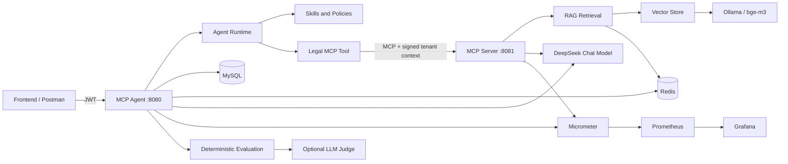

# Lawyer AI Assistant

An enterprise-style, multi-tenant legal AI Agent backend built with Java 21,
Spring Boot, and Spring AI. The project demonstrates Agent orchestration,
MCP-based legal tools, retrieval-augmented generation, production persistence,
security guardrails, observability, cost attribution, and repeatable quality
evaluation.

> This repository contains the backend platform only. The Vue frontend is
> maintained as a separate project and will be linked here after publication.

## Highlights

- Multi-step Agent runtime with planning, reasoning, reflection, replanning,
  bounded retries, no-progress detection, and SSE streaming.
- MCP Agent / MCP Server role separation with an internal legal knowledge tool.
- RAG pipeline with PDF ingestion, parent-document retrieval, source metadata,
  checksums, knowledge versions, incremental synchronization, and stale-document
  replacement.
- Redis and Caffeine cache adapters with tenant-aware, versioned keys, TTLs,
  persistence, and fail-open behavior.
- JWT authentication, tenant identity propagation, role-based authorization,
  tool authorization, prompt-injection defenses, and runtime resource limits.
- MyBatis, MySQL, and Flyway for production identity persistence.
- Token usage, model pricing, execution-level cost attribution, performance and
  cost guardrails, Prometheus metrics, and Grafana dashboards.
- Deterministic evaluation plus optional LLM-as-a-Judge evaluation with separate
  Agent and Judge token/cost boundaries.
- JUnit 5, Mockito, Testcontainers, integration tests, and ArchUnit rules.

## Architecture



Production exposure is intentionally narrow:

- MCP Agent (`8080`) is the public backend API.
- Grafana (`3000`) is exposed for the local demonstration environment.
- MCP Server, MySQL, Redis, Ollama, and Prometheus remain internal to the Docker
  network.

## Runtime Roles

### MCP Agent

The MCP Agent owns:

- authentication, JWT validation, and tenant identity;
- Agent orchestration and streaming;
- MCP client access;
- execution-level token and cost attribution;
- live evaluation and optional model Judge;
- production Flyway migration ownership.

### MCP Server

The MCP Server owns:

- legal MCP tool exposure;
- knowledge-base initialization and synchronization;
- RAG retrieval and evidence formatting;
- Ollama embedding access;
- retrieval cache access.

The MCP Server is not intended to be called directly by browser clients.

## Technology Stack

| Area          | Technology                                       |
| ------------- | ------------------------------------------------ |
| Language      | Java 21                                          |
| Application   | Spring Boot 4.0.7                                |
| AI framework  | Spring AI 2.0.0                                  |
| Chat model    | DeepSeek                                         |
| Embedding     | Ollama with `bge-m3`                             |
| Persistence   | MyBatis, MySQL 8, Flyway                         |
| Cache         | Redis 7, Caffeine                                |
| Security      | Spring Security, JWT, tenant-aware authorization |
| Observability | Micrometer, Prometheus, Grafana                  |
| Testing       | JUnit 5, Mockito, Testcontainers, ArchUnit       |
| Deployment    | Docker, Docker Compose                           |

## Prerequisites

- Docker Desktop with Docker Compose
- A DeepSeek API key
- At least 8 GB of free memory recommended for the complete local stack
- Java 21 and Maven 3.9+ only when running the backend outside Docker

The first Docker startup may take longer because Ollama downloads the configured
embedding model.

## Quick Start

### 1. Clone the repository

```bash
git clone https://github.com/quincedev/lawyer-ai-assistant.git
cd lawyer-ai-assistant
```

### 2. Create local environment configuration

PowerShell:

```powershell
Copy-Item .env.example .env
```

Bash:

```bash
cp .env.example .env
```

Set secure values in `.env` for at least:

```dotenv
DEEPSEEK_API_KEY=replace-with-your-key
SECURITY_JWT_SECRET=replace-with-a-long-random-secret
MYSQL_PASSWORD=replace-with-a-strong-password
MYSQL_ROOT_PASSWORD=replace-with-a-strong-root-password
GRAFANA_ADMIN_PASSWORD=replace-with-a-strong-password
```

Never commit `.env`. It is excluded by `.gitignore`.

### 3. Validate the effective production configuration

```powershell
docker compose `
  -f docker-compose.yml `
  -f docker-compose.prod.yml `
  config
```

### 4. Build the shared application image

Only `mcp-server` declares the image build. Both application roles use the same
resulting image with different Spring profiles.

```powershell
docker compose `
  -f docker-compose.yml `
  -f docker-compose.prod.yml `
  build mcp-server
```

### 5. Start the production-style stack

```powershell
docker compose `
  -f docker-compose.yml `
  -f docker-compose.prod.yml `
  up -d
```

### 6. Check service status

```powershell
docker compose `
  -f docker-compose.yml `
  -f docker-compose.prod.yml `
  ps
```

Agent readiness:

```powershell
Invoke-RestMethod `
  -Uri "http://localhost:8080/actuator/health/readiness"
```

MCP Server readiness:

```powershell
docker exec lawyer-ai-mcp-server `
  curl -fsS http://localhost:8081/actuator/health/readiness
```

## Authentication

Production does not seed demonstration users. Create an authorized test user in
MySQL according to the release runbook before calling protected APIs.

Login:

```http
POST /api/auth/login
Content-Type: application/json

{
  "username": "your-user",
  "password": "your-password"
}
```

Use the returned token for protected requests:

```http
Authorization: Bearer <access-token>
```

Current identity:

```http
GET /api/auth/me
Authorization: Bearer <access-token>
```

## Main APIs

| Method | Endpoint                            | Purpose                              | Access                |
| ------ | ----------------------------------- | ------------------------------------ | --------------------- |
| `POST` | `/api/auth/login`                   | Authenticate and issue JWT           | Public                |
| `GET`  | `/api/auth/me`                      | Return authenticated tenant identity | Authenticated         |
| `POST` | `/api/playground/agent`             | Run an Agent request                 | Authenticated         |
| `POST` | `/api/playground/agent/stream`      | Run an Agent request over SSE        | Authenticated         |
| `GET`  | `/api/playground/retrieval`         | Inspect retrieval behavior           | Authenticated         |
| `POST` | `/api/evaluation/live/run/{caseId}` | Run one evaluation case              | `DIRECTOR` / `ADMIN`  |
| `POST` | `/api/evaluation/live/run`          | Run the complete evaluation dataset  | `DIRECTOR` / `ADMIN`  |
| `GET`  | `/actuator/health/readiness`        | Readiness status                     | Public                |
| `GET`  | `/actuator/prometheus`              | Prometheus scrape endpoint           | Public in local stack |

Agent request example:

```http
POST /api/playground/agent
Authorization: Bearer <access-token>
Content-Type: application/json

{
  "goal": "Analyze the legal liability for an unlawful termination of employment."
}
```

Live evaluation is disabled by default because it invokes the real model and
incurs API cost. To enable it locally:

```dotenv
AI_LIVE_EVALUATION_ENABLED=true
AI_EVALUATION_JUDGE_ENABLED=true
```

## Testing

Run the complete verification lifecycle:

```powershell
mvn clean verify
```

The suite covers:

- domain and service unit tests;
- Spring profile and conditional-wiring tests;
- authentication, tenant, MyBatis, Redis, and MCP integration tests;
- deterministic evaluation and model Judge tests;
- Testcontainers-based infrastructure tests;
- ArchUnit dependency, role, naming, and framework-independence rules.

Some Testcontainers tests require Docker Desktop to be running.

## Evaluation Baseline

The verified live dataset contains five labor-law cases:

1. unlawful termination;
2. economic compensation;
3. probation termination;
4. overtime compensation;
5. labor arbitration limitation.

Final verified result:

| Metric                      |                     Result |
| --------------------------- | -------------------------: |
| Cases                       |                          5 |
| Passed                      |                          5 |
| Failed                      |                          0 |
| Pass rate                   |                       100% |
| Average deterministic score |                         98 |
| Prompt tokens               |                    131,105 |
| Completion tokens           |                     67,979 |
| Total Agent tokens          |                    199,084 |
| Agent cost                  |               USD 0.037393 |
| Judge cost                  | approximately USD 0.003685 |
| Usage-missing calls         |                          0 |
| Pricing-missing calls       |                          0 |

Agent cost and Judge cost are attributed independently to prevent duplicated
token accounting and distorted budget guardrails. Model output remains
non-deterministic; future runs may vary and should be interpreted using both the
deterministic result and Judge report.

## Observability

The application publishes Micrometer metrics for:

- Agent, LLM, Tool, and MCP calls and durations;
- cache hits and misses;
- retries and no-progress suppression;
- evidence compaction;
- prompt, completion, and total tokens;
- pricing coverage and Agent cost;
- deterministic evaluation;
- model Judge score, duration, tokens, failures, and cost;
- performance and cost guardrails.

Local endpoints:

```text
Prometheus metrics: http://localhost:8080/actuator/prometheus
Grafana:            http://localhost:3000
```

The stable metric contract is documented in
[`docs/observability/AGENT_METRICS_CONTRACT.md`](docs/observability/AGENT_METRICS_CONTRACT.md).

## Configuration Principles

- Base configuration remains infrastructure-neutral.
- `mcp-agent` owns public APIs, authentication, orchestration, evaluation, and
  Flyway migrations.
- `mcp-server` owns MCP legal tools and RAG infrastructure.
- `prod` selects MySQL, Redis, and production resource policies.
- Caffeine remains the local default; Redis is the production cache backend.
- Knowledge version is shared by retrieval metadata and cache keys.
- Real model prices must be supplied through environment variables. When prices
  remain `0` in `.env.example`, token usage is still recorded but calculated
  monetary cost remains zero.

## Security

- JWT authentication is stateless.
- Trusted tenant identity is derived from authenticated claims, not request
  parameters.
- Tool access is protected by authorization policies and risk classification.
- MCP calls propagate signed, short-lived execution identity.
- Input and output guardrails detect prompt injection and sensitive content.
- Runtime policies bound steps, retries, replans, Tool calls, execution time,
  context size, and evidence size.
- Sensitive and high-cardinality values are forbidden as metric tags.
- Secrets are supplied through environment variables or an ignored `.env` file.

`/actuator/prometheus` is public in the local demonstration stack so Prometheus
can scrape it. An internet-facing deployment must restrict this endpoint using
a private network, firewall, or reverse proxy policy.

## Documentation

- [Release and rollback runbook](docs/deployment/RELEASE_RUNBOOK.md)
- [Architecture dependency rules](docs/deployment/architecture/DEPENDENCY_RULES.md)
- [Agent metrics contract](docs/observability/AGENT_METRICS_CONTRACT.md)
- [Final verified baseline](docs/FINAL_BASELINE.md)

## Frontend

The frontend is intentionally maintained in a separate repository to preserve
a clean frontend/backend boundary. The frontend will communicate only with the
MCP Agent API and will not directly access the MCP Server, MySQL, Redis, Ollama,
or Prometheus.

The frontend repository link will be added after it is published.

## Known Limitations

- The current in-memory vector store is suitable for demonstration and local
  evaluation, not horizontally scaled production retrieval.
- Live evaluation and LLM-as-a-Judge invoke a real model, incur cost, and may be
  affected by provider rate limits or transient failures.
- Agent responses are probabilistic even when deterministic evaluation rules are
  stable.
- Prometheus authentication and public TLS termination are expected to be
  handled by deployment infrastructure.
- The local Docker stack is a production-style demonstration, not a complete
  high-availability deployment.

## License

No open-source license has been granted for this repository. Unless a license is
added later, the source remains subject to the repository owner's copyright.

