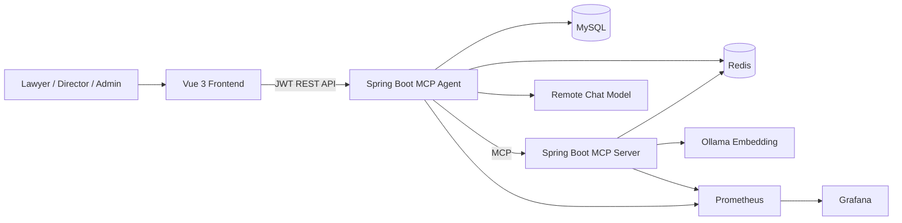
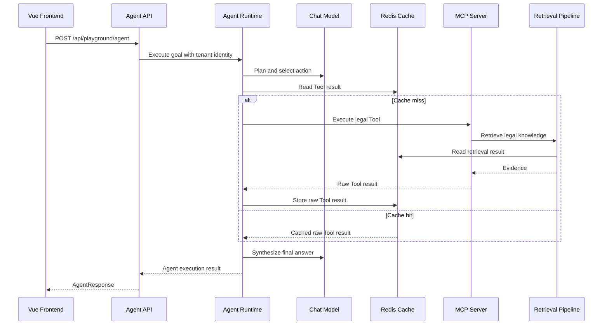
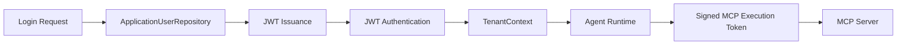
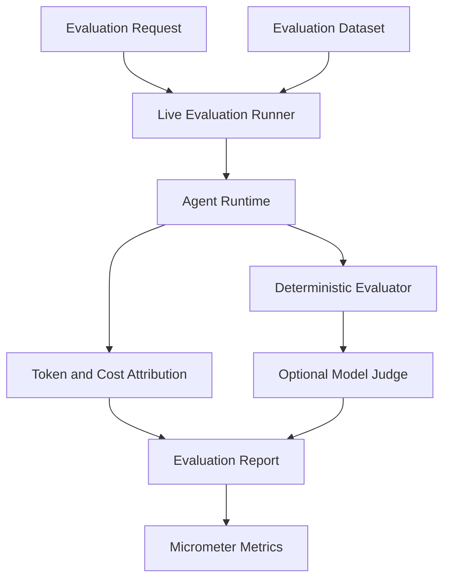

# Architecture

## Purpose

This document describes the runtime roles, dependency boundaries, data flows,
and operational ownership of Lawyer AI Assistant.

## System Context

Only the MCP Agent exposes the browser-facing application API. The MCP Server,
MySQL, Redis, Ollama, and Prometheus remain internal to the Docker network.

## Agent Execution

Authorization is evaluated independently of cache state. A cache hit never
bypasses tenant or Tool authorization.

## Authentication and Tenant Identity

Tenant identity is derived from authenticated claims. Tenant IDs, user IDs,
roles, and execution identity are never trusted from ordinary request fields.

## Evaluation Flow

Live evaluation is an internal administrative capability. Its endpoints are
restricted to `DIRECTOR` and `ADMIN` roles because evaluation invokes the real
model and can incur cost.

## Port and Adapter Boundaries

Core contracts do not depend on infrastructure implementations.

| Port                        | Local adapter | Production adapter |
| --------------------------- | ------------- | ------------------ |
| `ToolResultCache`           | Caffeine      | Redis              |
| `RetrievalCache`            | Caffeine      | Redis              |
| `ApplicationUserRepository` | In-memory     | MyBatis/MySQL      |

Infrastructure adapters implement application-owned interfaces. ArchUnit rules
protect these dependency directions and prevent framework dependencies from
leaking into domain models.

## Runtime Role Ownership

### MCP Agent

The MCP Agent owns:

- authentication and JWT validation;
- tenant identity restoration;
- Agent planning and orchestration;
- remote model calls;
- MCP client access;
- execution metrics, token usage, and cost attribution;
- live evaluation and optional model Judge;
- production Flyway migrations.

### MCP Server

The MCP Server owns:

- legal MCP Tool exposure;
- RAG retrieval and evidence formatting;
- knowledge-base loading and synchronization;
- source, version, and checksum metadata;
- Ollama embedding access;
- retrieval cache access.

The MCP Server does not own public authentication APIs and does not execute
Flyway migrations.

## Persistence Ownership

MySQL stores production application users and roles. MyBatis adapters implement
the identity repository contract. Flyway is enabled only for the MCP Agent in
the production profile, ensuring that migrations have a single owner.

## Cache Semantics

Redis is a performance optimization, not a source of authorization truth.

- cache keys are tenant-aware and knowledge-version-aware;
- Tool cache stores raw Tool results;
- security checks execute even on cache hits;
- TTL semantics match the Caffeine adapters;
- Redis failures are fail-open when configured;
- cache failures must not interrupt the primary Agent workflow.

## RAG Knowledge Lifecycle

Knowledge documents carry stable metadata including source, version, checksum,
tenant scope, and knowledge scope.

Synchronization detects:

- new sources;
- unchanged sources;
- changed sources;
- removed sources.

Changed sources replace stale parent documents and chunks. Knowledge-version
changes invalidate retrieval cache keys.

## Observability

Micrometer records stable:

- Agent execution metrics;
- duration metrics;
- downstream call metrics;
- cache metrics;
- token metrics;
- cost metrics;
- guardrail metrics;
- evaluation metrics.

Prometheus scrapes the MCP Agent and MCP Server. Grafana visualizes operational
behavior.

Sensitive and high-cardinality values such as tenant IDs, user IDs, questions,
answers, execution IDs, and tokens are forbidden as metric tags.

## Failure Boundaries

- Redis failures can fail open.
- Model pricing gaps record missing-pricing metrics without fabricating cost.
- Token usage gaps are explicitly counted.
- Model Judge failure behavior is configurable and isolated from Agent cost.
- Runtime steps, retries, replans, Tool calls, duration, and evidence size are
  bounded by policy.
- External errors are translated into sanitized API responses.

## Architecture Enforcement

Architecture regression tests verify:

- domain model framework independence;
- Port and Adapter dependency direction;
- Agent, MCP, and RAG role boundaries;
- configuration and annotation naming conventions;
- repository and cache implementation isolation.

The complete architecture suite runs during Maven Verify and GitHub Actions.